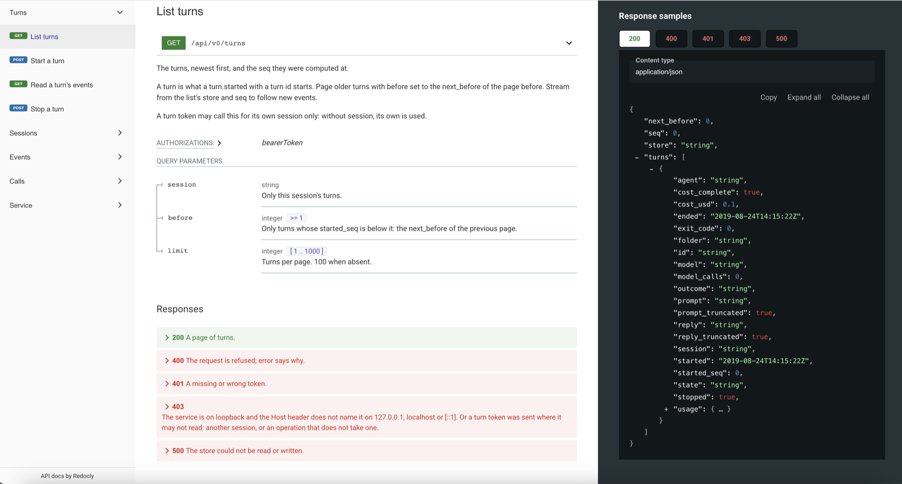

<div align="center">

<picture>
  <source media="(prefers-color-scheme: dark)" srcset="docs/assets/agentbus-logo-dark.svg">
  
</picture>

**A cross-vendor middleware framework for coding agents.**

[](https://github.com/staysup/agentbus/stargazers)
[](https://github.com/staysup/agentbus/releases)
[](https://github.com/StaysUp/agentbus/actions/workflows/ci.yml)

[Quickstart](#quickstart) &nbsp;&bull;&nbsp; [Docs](#docs) &nbsp;&bull;&nbsp; [Cockpit](https://github.com/staysup/agentbus-cockpit) &nbsp;&bull;&nbsp; [Releases](https://github.com/staysup/agentbus/releases)

</div>



AgentBus is a cross-vendor middleware framework for coding agents. It sits between your agents and every model vendor.

## Why

- **You see every model call.** Each request and reply an agent makes passes through AgentBus and
  is stored on your machine.
- **You see the cost.** Every call is priced, and each turn and session shows its total.
- **The conversation is kept.** Each turn is a fresh one-shot agent run. AgentBus keeps the history
  and continues the conversation from its own store.
- **Any vendor.** Claude Code and codex today, through one API. Every vendor tomorrow.

AgentBus runs the agents you already have, signed in as you.

## Prerequisites

- `claude` (Claude Code) or `codex`, or both, installed and signed in.
- macOS or Linux.
- Go 1.27.1 or later, only if you install with `go install` or build from source.

## Install

Pick one.

**Homebrew:**

```sh
brew install staysup/tap/agentbus
```

**Install script** (puts `agentbus` in `~/.local/bin`):

```sh
curl -fsSL https://raw.githubusercontent.com/staysup/agentbus/main/install.sh | sh
```

**Go:**

```sh
go install github.com/staysup/agentbus/cmd/agentbus@latest
```

**Build from source:**

```sh
git clone https://github.com/staysup/agentbus.git
cd agentbus
go install ./cmd/agentbus
```

Both Go routes put `agentbus` in `$(go env GOPATH)/bin`. That folder must be on your `PATH`:

```sh
export PATH="$PATH:$(go env GOPATH)/bin"
```

Check the install with `agentbus version`.

## Quickstart

### 1. Start the service

```sh
agentbus up
```

It listens on `http://127.0.0.1:8787` and prints its data folder:

```
agentbus: 2026/11/06 12:00:00 listening on http://127.0.0.1:8787, data folder /Users/you/.local/share/agentbus
```

The data folder is `$AGENTBUS_HOME` if set, else `$XDG_DATA_HOME/agentbus`, else
`~/.local/share/agentbus`. On first start AgentBus writes a random token to `token` in that folder,
readable only by you. Every API request needs it.

Flags:

| Flag | Default | What it does |
|---|---|---|
| `-listen` | `127.0.0.1:8787` | The address: an IP, with or without a port. With no port it uses 8787. `0.0.0.0` can be reached from the network. |
| `-origin` | none | An optional lock: allow only this browser origin, such as `http://localhost:5173`. Without it any origin may call the API. |
| `-replay` | `true` | Continue Claude and codex sessions from AgentBus's own store. `false` uses the agent's own resume. |
| `-max-runs` | `4` | How many turns run at once, 1 to 64. More wait in the queue. |

### 2. Open a cockpit

A cockpit is any client of the API. The browser cockpit is in its own repository,
[staysup/agentbus-cockpit](https://github.com/staysup/agentbus-cockpit). It works with the plain
`agentbus up` from step 1. Follow the cockpit's README, and paste the token from the token file
when it asks.

A page from any origin may call the API, because every call needs the token in a header and a
foreign page does not have it. AgentBus uses no cookies, so there is nothing for the browser to
send on your behalf. To lock the API to one origin anyway, start it with
`agentbus up -origin http://localhost:5173`.

### Reach it from another machine or a container

By default the service answers this machine only. To reach it from elsewhere, listen on every
address:

```sh
agentbus up -listen 0.0.0.0
```

In Docker, run that inside the container and publish the port to your own machine only:

```sh
docker run -p 127.0.0.1:8788:8787 ...
```

The cockpit then uses `http://127.0.0.1:8788` with the same token.

On `0.0.0.0` the service can be reached from the network. The token guards every API call. The
agents' model traffic answers callers on the service's own machine only. There is no HTTPS, so
across a network use an SSH tunnel or a private network. If you put a reverse proxy in front, pass
on `/api` and `/docs` only: the proxy's requests look local to the service.

### 3. Or start a turn with curl

Open a second terminal in any folder. First check that the service finds your harnesses:

```sh
TOKEN=$(cat ~/.local/share/agentbus/token)

curl -s -H "Authorization: Bearer $TOKEN" http://127.0.0.1:8787/api/v0/harnesses
```

Each one says `found`, its `version` and `signed_in`. `GET /api/v0/agents` lists your saved
agents; a new data folder has `claude` and `codex`, each on its own subscription.

`found` means the harness's program is on the service's `PATH`. `signed_in` is the harness's own
answer, and it is left out when it gives no clear one. Start a turn only with an agent whose
harness is found and signed in.

Then start a turn:

```sh
curl -s http://127.0.0.1:8787/api/v0/turns \
  -H "Authorization: Bearer $TOKEN" \
  -H "Content-Type: application/json" \
  -d '{"agent":"claude","folder":"'"$PWD"'","prompt":"Say hello in five words.","model":"haiku","read_only":true}'
```

Use your own token path if the data folder is elsewhere. `folder` must be an absolute path to a
folder that exists. In a git repo with a commit, the agent works in its own git worktree of it, at
its current HEAD, under the data folder; send `"isolate":false` to work in the folder itself. `model` is passed to the agent as `--model`; a small
model keeps this first turn cheap. `read_only` gives the agent read tools only. For codex, use
`"agent":"codex"` and one of its models, or leave `model` out.

The reply names the new session (`id`) and turn (`turn`):

```json
{"id":"8c1f…","turn":"t_5d0c19a2e7b3f481","base_url":"http://127.0.0.1:8787/s/8c1f…/t/t_5d0c19a2e7b3f481"}
```

If the service cannot find the agent's program, the reply is HTTP 400 and nothing is stored:

```json
{"error":"agent claude cannot start: the program claude is not on the service's PATH. Install Claude Code and run claude once to sign in, then try again. If it is installed, start agentbus from a shell where claude runs."}
```

Read the turn back, with its reply, state and cost (`GET /api/v0/turns/<turn>` reads just one):

```sh
curl -s "http://127.0.0.1:8787/api/v0/turns?session=<id>" -H "Authorization: Bearer $TOKEN"
```

To make a retry safe, add `"idempotency_key":"<your id>"`. Sending the same body again returns the
same turn and starts nothing.

To continue the conversation, send the next prompt with `"session":"<id>"` and no agent or folder.

To stop a running turn, and every process it started:

```sh
curl -s -X POST "http://127.0.0.1:8787/api/v0/turns/<turn>/stop" -H "Authorization: Bearer $TOKEN"
```

The next turn of the session continues after it, and the agent is told that you stopped it.

## Jobs, Review and CI/CD

Every turn runs as a job. `agentbus up` keeps a job queue and runs a runner in the same process,
so there is nothing else to start. The runner takes each job and runs it as a turn. The cockpit
reads the jobs from the same address with the same token.

- **A job can run in its own git worktree.** Name a `repo` and a `base` (a branch, tag or commit),
  and the runner makes a worktree for the session. Your own checkout is not touched. The work
  stays in the worktree until you close it. Nothing is committed or pushed.
- **Every job records what it changed**: each file added, modified or deleted, untracked and
  git-ignored files too, not only `git diff`.
- **Review is another job.** It runs read-only in the author's workspace, with another agent and
  model, and ends with a verdict (pass, fail or unknown) and its findings. Any P1 makes it fail.
- **Fix is the session's next turn**, in the same workspace, with the findings as its prompt.

In the cockpit: start a session with New worktree, open the turn, pick a reviewer under Checked by,
and press Review. If it fails, press Fix, then Send, then Review again. With curl, see
[Jobs](docs/CLIENT_API.md#jobs).

## Modes

One program, three ways to run it:

| Command | What runs | For |
|---|---|---|
| `agentbus up` | The API, the job queue, the record, the gateway and a runner, in one process | One person on one machine. The default. |
| `agentbus server` | The API, the job queue, the record and the gateway, with no runner | A central queue that runners on other machines pull from. |
| `agentbus runner -server <url>` | A runner, with its own gateway and record | Any machine that should run jobs for a server. |

A runner pulls work and is never called, so it works behind NAT. It always talks to the queue
through the runner protocol over HTTP, the built-in one in `agentbus up` included.

```sh
# On the central machine:
agentbus server -listen 0.0.0.0
# On each runner machine, with the server's enroll_token file copied over (mode 0600):
agentbus runner -server http://central:8787 -enroll-token-file ./enroll_token
```

The runner's data folder is its own (`AGENTBUS_HOME`, as for `agentbus up`): a runner on the same
machine as its server needs another one. Its own service listens on a free loopback port, for its
agents only.

Where agents send model calls is the one setting per mode, `-gateway` on `agentbus runner`:

- `local` (the default): the runner's own gateway, on its machine. The agent signs in as the person
  on that machine, and the turn's record stays there. The job's result, with the reply, the cost
  and the changed files, goes to the server.
- `server`: the server's gateway, so the record is central and runners hold no secrets. **Not yet
  built**: it needs API keys added by the gateway, and the server's gateway to take calls from
  other machines.

## Docs

The running service describes its own API. None of these need the token or the internet:

- `http://127.0.0.1:8787/docs`: an interactive reference.
- `http://127.0.0.1:8787/api/v0/openapi.json`: the OpenAPI 3.1 description. Generate a client from
  it in any language. There are no client SDKs.
- `http://127.0.0.1:8787/docs/llms.txt`: one plain file for coding agents.

The contract in words is [docs/CLIENT_API.md](docs/CLIENT_API.md).

## Your data

Everything stays on your machine, in the data folder: `events.db` (a SQLite file, the record),
`jobs.db` (the job queue), `token`, `turns_token`, `enroll_token`, `runner.json`,
`permissions.toml`, `instructions.md`, `agents.json`, `worktrees/` and `logs/`. `turns_token` is a second token for a program that
only starts, stops and reads turns. `enroll_token` adds a runner; the built-in runner reads it, and
keeps its identity in `runner.json`. `worktrees/` holds the git worktrees jobs run in. Nothing is sent anywhere except the model calls themselves, to the vendor your agent
already uses.

`events.db` holds each turn's model requests and replies, so it holds whatever your agent read or
printed during a turn, such as a file it opened or a command's output. It is not encrypted, and it
is kept until you remove it. Request headers, including your sign-in, are never stored.

To clear it, stop `agentbus up` and delete the data folder. A new one is made on the next start.

## Permissions

A turn runs with no person to click "allow". So a claude turn is refused anything that needs a
"may I?", such as `go test` or reading a folder outside its own. `permissions.toml` in the data
folder says what turns may do:

```toml
read_folders = ["~/.agents"]           # claude may Read, Grep and Glob there
allow = ["go test", "make test"]       # claude gets --allowedTools Bash(go test:*),...
forbid = ["git push", "git checkout"]  # the gateway refuses these, for claude and codex
edit = "session"                       # where a turn may edit files: "session" or "none"

[limits]                     # work agents ask other agents for
max_depth = 2                # levels of asking below your turn
max_jobs_per_turn = 10       # jobs one turn may ask for
max_jobs_per_tree = 30       # jobs everything started from one of your sessions may ask for
max_cost_usd_per_tree = 0.0  # dollars that work may cost before asking stops; 0 is off

[agent_api]                  # what a turn's own token may do
scope = "tree"               # "tree": its request tree; "session": its own session only
read = true                  # read sessions, turns, calls and jobs
list_agents = true           # list saved agents and harnesses
start = true                 # start a session on a saved agent
continue = true              # continue a session its tree started
review = true                # ask for a review
cancel = true                # cancel what it asked for
rename = true                # rename sessions
```

`agentbus up` makes it with empty lists and every other value at its default, as above. A key you
leave out reads as its default, so an older file keeps working. Every turn reads the file when it
starts, and the API reads it for every request a turn's token sends, so an edit applies at once.
A broken file stops the turn with the line and the problem.

**Edits.** With `edit = "session"`, a turn edits files in its own session folder (its worktree)
without asking: claude gets `Edit(//<folder>/**)`, codex runs with `--sandbox workspace-write`.
`"none"` edits nothing: claude is denied Edit, Write and NotebookEdit, whatever your own Claude
Code settings allow, and codex runs read-only, with no network. A `read_only` turn never
edits. No turn may edit the data folder's own files (this file, `instructions.md`, `agents.json`,
the tokens): a turn that could would raise its own limits. That rule is not a setting. It covers
the tools that edit files: a command in `allow` that runs any code (`python3`, `node`, `sh`) can
still write them, so allow only commands you would let change your policy.

**Limits.** A request past a limit is refused, and the refusal names the limit.

`read_folders` grants reads only in the default and acceptEdits modes. Under your own Claude Code
"auto" mode, claude may still write there.
A `read_only` turn stays read-only.

`forbid` works for claude and codex. The gateway reads each model reply. When a shell command in
it matches an entry, the agent never gets that call, and the model is told a rule refused it. Each
command in a chain is checked on its own, so `cd repo && git -C repo push` matches `git push`.
Every refusal is stored as a `tool.refused` event. claude also gets `--disallowedTools`.

The guard reads the command text. It cannot see a command built while the agent runs, or one run
from a script the agent wrote earlier. For a hard rule, also take away what the command needs. For
"never push", give the agent no push credentials.

codex gets nothing from `read_folders` and `allow`. Its sandbox can read every folder already.
Details: [docs/CLIENT_API.md](docs/CLIENT_API.md#permissionstoml).

## Instructions

Every turn gets the same short instructions, as an instruction of its agent's own (Claude Code's
`--append-system-prompt`, codex's `developer_instructions`), never inside your prompt. They are the
text of `instructions.md` in the data folder. `agentbus up` writes it with the default: how to
search the session's earlier turns and ask other agents with `agentbus-api`. Edit it to change what
every agent is told; `{session}` becomes the session id. An empty file gives no instructions, and a
missing one the default. Each turn reads it when it starts. Keep it the same within a session, so
the prompt cache holds.

## How it works

- **The agent changes one setting**, its API address. It also gets the instructions in
  `instructions.md` (Claude Code's `--append-system-prompt`, codex's `developer_instructions`),
  saying how to search its session's earlier turns and ask other agents with the turn's own token.
  Your prompt is never changed.
- **Traffic passes through.** Requests go to the vendor with their headers, so the agent's own
  sign-in is used. Headers are never stored. The one change: a turn that continues a session gets
  the earlier turns' history put in front of its requests. For codex, the earlier turn's thread id
  also replaces the new one, so the vendor reads the history from its cache.
- **Adapters read a copy** of each body and turn the vendor's format into the same events.
- **Your sign-in stays on your machine.** Agents reach the service on loopback, even when it
  listens on `0.0.0.0`, and the model traffic answers callers on that machine only.

| Path | What it is |
|---|---|
| `cmd/agentbus/` | The `agentbus` command |
| `api/` | The client API and its generated docs |
| `run/` | Starts one turn of a stock agent CLI, watches it and stops it |
| `queue/` | Jobs, attempts, runners and reviews, in `jobs.db` beside the record |
| `jobs/` | The jobs API and the runner protocol |
| `runner/` | Takes jobs through the runner protocol and runs each one with `run/` |
| `workspace/` | Git worktrees, and what a job changed |
| `gateway/` | The pass-through proxy that feeds adapters |
| `adapter/` | One adapter per API format: Anthropic, OpenAI |
| `event/` | The vendor-neutral events |
| `store/` | The SQLite store |
| `replay/` | Own replay: continues Claude and codex conversations from the store |
| `cost/` | Prices every model call |

Third-party code shipped in the binary is listed in [THIRD_PARTY.md](THIRD_PARTY.md).

## License

Free to use, change and run, including inside your business. You can't sell it as a competing product or service. Each release becomes Apache 2.0 two years after it is published.

Licensed under the [Functional Source License](https://fsl.software) (FSL-1.1-ALv2). See [LICENSE](LICENSE).
