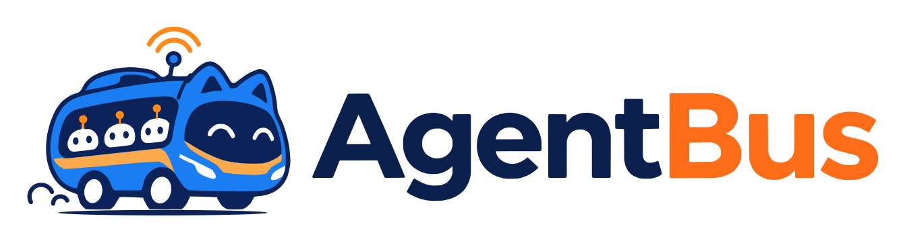
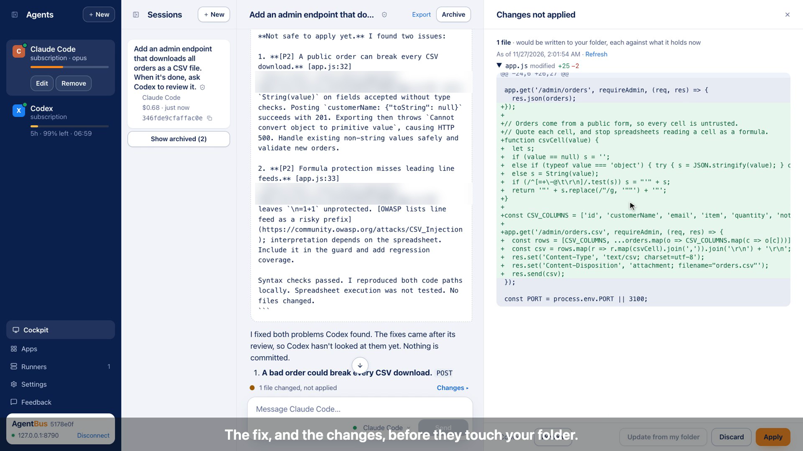

<div align="center">

<picture>
  <source media="(prefers-color-scheme: dark)" srcset="docs/assets/agentbus-logo-dark.svg">
  
</picture>

**Control every AI agent in a single place.**

[](https://github.com/staysup/agentbus/stargazers)
[](https://github.com/staysup/agentbus/releases)
[](https://github.com/StaysUp/agentbus/actions/workflows/ci.yml)

[Quickstart](#quickstart) &nbsp;&bull;&nbsp; [Demo](https://github.com/user-attachments/assets/06bb50b3-1b9a-4656-a2dd-fe836de0a87e) &nbsp;&bull;&nbsp; [Docs](#docs) &nbsp;&bull;&nbsp; [Releases](https://github.com/staysup/agentbus/releases)

</div>

[](https://github.com/StaysUp/agentbus/releases/tag/v0.6.7)

AgentBus sits between your coding agents and every model vendor. It runs the agents you already
have (Claude Code, Codex, Antigravity, OpenCode or any OpenRouter model) and tracks every step.

- **Your agents work together.** Claude can ask Codex, or any agent from any vendor, to answer a
  question, take on a task or check its work. The answer comes back into the same session.
- **You see every model call**, and what it cost: exactly what each model was sent, piece by piece,
  and what it answered.
- **Your folder stays as it is.** A Copy session works in its own copy of your folder. The agent's
  commands write only there. You review the changes, then apply them to your folder or drop them.
  Several sessions can work on the same code at once. A Direct session works in your folder itself,
  like your terminal.
- **Everything stays on your machine.** Your sessions, every model call and reply, and your sign-ins
  and keys are kept in AgentBus's data folder on your machine.

## Install

You need macOS or Linux, and `claude`, `codex`, `agy` or `opencode` installed. Use **one** of these:

**Install script** (puts the binary in `~/.local/bin`):

```sh
curl -fsSL https://raw.githubusercontent.com/staysup/agentbus/main/install.sh | sh
```

**Homebrew** (macOS or Linux):

```sh
brew install staysup/tap/agentbus
```

**From source** (Go 1.27.1 or later):

```sh
go install github.com/staysup/agentbus/cmd/agentbus@latest
```

A source build has no cockpit. Use the install script or Homebrew to follow the Quickstart, or from a clone run `tools/pack-cockpit.sh` then `go build`.

The install script takes `AGENTBUS_INSTALL_DIR` (another folder) and `AGENTBUS_VERSION` (another
release). Check the install with `agentbus version`. If `~/.local/bin` is not on your PATH, the
script prints the exact line to add for your shell (zsh, bash or fish); it never edits a profile.

## Quickstart

A first run, from nothing to two vendors talking about the same work. You need `claude` and `codex`
installed, and a Claude and a ChatGPT subscription.

1. **Start AgentBus.**

   ```sh
   agentbus up -open
   ```

   It prints a sign-in link, `http://127.0.0.1:8787/?t=…`, and with `-open` opens it in your
   browser. Without `-open` it only prints the link. The cockpit comes with
   `agentbus up`: nothing else to install. The link works once, for 10 minutes. The link expired?
   Stop `agentbus up` (Ctrl-C) and start it again for a new one.

   In another tab or browser, paste your token on the connect screen instead. The token is the file
   `token` in the data folder that `agentbus up` prints when it starts (`$AGENTBUS_HOME`, by default
   `~/.local/share/agentbus`). Copy it
   without showing it: `pbcopy < ~/.local/share/agentbus/token` on a Mac, or
   `xclip -sel c < ~/.local/share/agentbus/token` on Linux. Anyone with the token controls your
   agents, so keep it to yourself.

2. **Add your agents.** A new AgentBus starts with no agents. Press **+ Agent** at the top of the
   Agents column, pick Claude Code, and press **Create agent**. Do the same for Codex.

3. **Connect your subscriptions.** Open **Settings** (at the foot of the Agents column), then
   **Subscriptions**. Press **Connect** next to Claude Code and sign in as it asks. Do the same for
   Codex. You do this once.

4. **Bring your setup (optional).** In **Settings**, **Config**, press **Use my config**, look over
   the list and save. Your settings, skills, MCP servers and logins such as `gh` and `aws` then come
   into every session.

5. **Ask Claude something.** Press **+ Session**, pick Claude Code, type the path of a project
   folder, write a first message such as "what does this project do?", and press **Start**.

6. **Ask Codex about it.** In the same session, switch the agent beside Send to Codex, and send
   "what do you think about the answer above?". Codex reads Claude's answer and gives its own.

Every turn and every model call is now in the record, with its cost.
By default (`-replay`), `agentbus up`, `server` and `runner` continue Claude and Codex sessions by sending the earlier turns' history through the gateway. Pass `-replay=false` when you want to use the vendor's own session resume instead. AgentBus keeps that history within a budget by itself (40% of the model's window by default, `budget` in `/api/v0/settings/compaction`): older turns' long tool output becomes stubs the agent can fetch back, and the oldest turns become a short summary, while the record keeps every byte.

### Sign-ins and keys

Every turn uses the sign-in you connect in Settings. This one path, **Connect**, is used in every
mode. Your tool's own sign-in on this machine (`~/.claude`, `~/.codex`) is not touched: AgentBus
gives the agent a stand-in and swaps in the real token at the gateway, so recording is never
bypassed. A turn whose tool is not connected is refused with "connect your claude subscription in
Settings".

On `agentbus up`, a turn runs in your real home, so the rest of your setup comes along: your
`CLAUDE.md`, hooks, plugins, skills, and logins such as `gh`, `aws`, `ssh` and `gitconfig`. Only the
vendor sign-in goes through Connect.

An agent can also use an API key instead of a subscription. Paste the key once in Settings,
Subscriptions: an OpenRouter key for any OpenRouter model, or the vendor's own key (Anthropic for
Claude Code, OpenAI for Codex, Gemini for Antigravity). AgentBus keeps it, adds it only to that
vendor's model calls, and never shows it again or gives it to an agent. **Replace** and **Remove**
change it.

An agent reaches its model in one of three ways, its **access**:

- `subscription`: the subscription connected in Settings. The model is optional.
- `openrouter`: an OpenRouter key. The model is required and is written in OpenRouter's naming.
- `api`: the vendor's own API key set in Settings (Anthropic for Claude Code, OpenAI for Codex, Gemini
  for Antigravity). The model is optional.

OpenCode (`npm install -g opencode-ai`) runs on `openrouter` only.

### Use any model

Claude Code can run on any model OpenRouter offers: the agent still runs Claude Code, but the model
behind it changes. From an empty AgentBus:

1. **Add an OpenRouter key.** Open **Settings**, **Subscriptions**, and paste your OpenRouter key
   once. AgentBus keeps it and adds it only to OpenRouter model calls.
2. **Add a Claude Code agent.** Press **+ Agent**, pick Claude Code, name it, set access to
   `openrouter` and model to an id in OpenRouter's naming, such as `openai/gpt-oss-120b` (GPT) or
   `deepseek/deepseek-v4.1-flash` (DeepSeek), then press **Create agent**. `openrouter` needs a model.
3. **Start a session.** Press **+ Session**, pick the agent, type your project folder, write a first
   message such as "what does this project do?", and press **Start**.
4. **Have another model check it.** Add a second Claude Code agent the same way with a different
   model id. In the same session, switch the agent beside Send to it and send "check the work
   above". Its reply comes back into the session, as Codex's does in the Quickstart.

Claude Code's tools are tuned for Claude, so other models may behave differently; give clear steps
and read what they reply.

## How a session runs: Direct, Copy, Locked

When you start a session you pick how it runs. The choice is remembered.

- **Copy (default).** The session works in its own copy of your folder. The agent's commands write
  only inside the copy, plus temporary files and the session's own package and build caches, never
  your own cache folders. Closing the session removes its caches. Reads across your disk stay open.
  The network works as normal. For Claude Code it is a list of hosts, and Docker and other local
  services need a Direct session; [Limits](#limits) says why. Several sessions can work on the
  same code without stepping on each other.
- **Direct.** The session works in your folder itself, like your terminal. Nothing is held back.
- **Locked.** Copy, plus hidden secrets and no writing to the internet. This comes later; the
  selector shows it, disabled.

A Copy session brings your setup in read only, leaving out the agents' own login files so Connect's
sign-in is used.

### Review, apply, discard

A Copy session's **workspace** holds its copy, and its file changes are held for you. Open the
session, read what each turn changed, and ask another model to check it with **Review**, right next
to Apply. Then **Apply** writes the changes into your folder, or **Discard** drops the copy. What a
turn's commands did outside the copy is shown in the turn view; it is not undone.

## Settings

Settings apply to every session, from the next turn. Change them on the cockpit's Settings page, or
through the API (`/api/v0/settings/permissions` and `/api/v0/settings/instructions`; the keys and
their defaults are in `/docs`, under Settings).

- **Permissions:** whether an agent may apply its own changes (off by default; you always may), then
  rules by name, over **Commands** and **Tools**. **Allow** runs without asking, **Ask** holds the
  call, and **Forbid** never runs it. By default Allow holds `*` (every command) and `tool:*` (every
  tool) and Forbid holds `tool:subagent`, so everything runs except starting subagents; narrow the
  lists to hold or refuse what you choose. A command or tool on none of the lists is held for a
  person. Starting subagents and editing files are tools too (`subagent`, `edit`), so they are ruled
  like any other. On **Ask** the call is held for up to 60 seconds while a card above the message box
  waits for you: **Allow once** runs it in the same turn, **Always allow** runs it and allows it from
  then on, and **Refuse** or no answer in time returns a plain refusal. Forbid wins over Ask, Ask over
  Allow. Agents reach the record, and apply and stop a turn, through `agentbus-api`.
- **Config:** files from your home copied into each session's home at each turn: your
  settings, skills, MCP servers and logins. **Use my config** fills the list. Sign-ins are never
  copied.
- **Limits:** how much work one message may cause: how deep agents may ask each other, how many
  turns, and the cost; and how many turns agents start may run at once (see [Limits](#limits)).

Whether a session runs Direct, Copy or Locked is a per-session choice in **New Session**, not a
global setting; see [How a session runs](#how-a-session-runs-direct-copy-locked). A Copy's folder is
cloned copy-on-write where the disk supports it, so a big `node_modules` costs nothing to copy.

## Limits

Turns you send start at once. They wait only for a turn already running in their workspace (one
copy runs one turn at a time) and for their own session's earlier turns. They never wait for work
agents asked for that has not started yet, even in the same workspace: your message goes ahead of it.

Turns agents start are **delegated** work: a turn an agent asks for (`ask_agent`, a review it
starts, a turn it sends with `agentbus-api`), in any session, your own included, and a reply
AgentBus delivers into a session an agent started. Who asked decides it, not where the turn runs. One runner runs at most
**8** of them at once. More wait in the queue, oldest first, and start as places free up. A reply
delivered into your own session counts as yours.

The number is `[limits] max_delegated_at_once` in the settings
(`/api/v0/settings/permissions`), 1 to 64. A change holds for the next turn a runner takes, with no
restart. The Runners page shows how it stands, such as "8 at once, 5 busy, 2 waiting"
(`delegated` in `GET /api/v0/runners`). A runner on another machine can set its own lower ceiling
with `agentbus runner -capacity N`.

## Known limits

- Ask works for plain commands such as `git push origin main`. A Claude Code command chained with `;`
  or `&&`, or started with environment variables, is checked by Claude Code's own rules too, which
  can block it even after you allow it. AgentBus runs every command and tool call through one rules
  list, by name; the vendor's own rules still apply on top.
- A Copy session walls each command, not the whole agent, through the vendor's own per-command
  sandbox. On Ubuntu 24.04 and later, AppArmor allows user namespaces only to a program with a
  profile, so that wall needs one. The install script offers it when it installs into a
  folder only root can change: `curl -fsSL https://raw.githubusercontent.com/staysup/agentbus/main/install.sh | sudo AGENTBUS_INSTALL_DIR=/usr/local/bin sh`.
  The profile is `packaging/apparmor/agentbus`, also in each release archive. AgentBus says what is
  missing. The fallback is `sudo sysctl kernel.apparmor_restrict_unprivileged_userns=0`, which turns
  the rule off for every program, so the profile is the better choice.
- **Copy does not hide your secrets.** Reads across your disk stay open, so `~/.aws`, `~/.ssh` and
  git credentials work as in your terminal, and a `.env` in a folder you read is visible. Only the
  agents' own login files are hidden, so Connect's sign-in is used. Hiding secrets comes with
  **Locked**, later.
- **Claude Code's Copy network is an allow-list, not fully open.** Its sandbox engine has no open
  setting and refuses `*`. AgentBus allows the gateway, localhost, GitHub (`gh` included), the
  package registries (npm, Yarn, PyPI, Go, crates). A command that calls any other host is refused.
  Go tools such as `gh` verify TLS as in your terminal.
- **Docker does not work in a Claude Code Copy session.** Use a Direct session for it. A Docker bind
  mount would let a command write outside the copy, so the copy allows no local sockets: Docker's,
  Lima's and ssh-agent's are closed too. `limactl start` also writes under `~/.lima`, outside the
  copy.
- **A Copy session's caches start empty.** Go, pip, uv, npm and Homebrew keep their caches in the
  session's own folder, so its first build or install downloads and compiles again. Go's module
  cache (`~/go/pkg/mod`) is read as it is and not written. On a Mac the Keychain's own files and
  the per-user temporary folder under `/var/folders` stay writable: `gh` and `mktemp` need them.
- Socket grants in your own managed or MDM settings, and socket paths in your user settings, still
  apply in a Copy session. This closes in 0.6.8.
- Codex's Copy network is truly open. Antigravity and OpenCode have no command sandbox of their own
  yet, and the gateway's check on file edits outside the copy reads Claude Code's calls only. So in
  a Copy session their commands and file edits can write outside the copy.
- On ext4 a copy is a full copy. A clone (APFS) or a reflink (xfs, btrfs) is used where the disk can
  make one.
- AgentBus has no file tools of its own: an agent reaches files through its CLI's built-in tools,
  and the gateway refuses a file edit outside the copy with a plain reason.
- MCP servers in your config load on every turn, reviews included. On a Mac, a server that
  signs in with OAuth keeps its token in the Keychain, and macOS asks to let the session read it;
  deny it to keep that server off. What a server does is outside AgentBus's record.
- Claude's browser (Chrome) cannot run in AgentBus sessions: it needs the tool's own sign-in.
- Antigravity: use it with a Gemini API key (Settings, Subscriptions). Its Google sign-in does not
  work through AgentBus yet: before any work it checks your account with Google directly, outside
  AgentBus, and that check fails. It gets no instructions from AgentBus, a turn with forbidden
  commands set is refused on it, and it cannot turn off its own subagents.
- OpenCode runs on an OpenRouter key only; its own provider sign-ins are not used yet. It gets no
  instructions and no AgentBus tools from AgentBus (it reaches the API through `agentbus-api`), and
  its sessions continue by its own resume. A turn with forbidden or asked commands set is refused on
  it, and a command on none of the lists is refused rather than held for you. In a folder below the
  root of a git repository it runs without edits, since OpenCode would edit the whole repository.

## Docs

The running service describes its own API, without the token or the internet:

- `http://127.0.0.1:8787/docs`: the API reference, as a page.
- `http://127.0.0.1:8787/api/v0/openapi.json`: the same, as OpenAPI 3.1. It is the contract.
  Generate a client from it in any language.
- `http://127.0.0.1:8787/docs/llms.txt`: one short page for coding agents.

Running agents on more than one machine is in [docs/RUNNER_PROTOCOL.md](docs/RUNNER_PROTOCOL.md). Third-party
code in the binary is listed in [THIRD_PARTY.md](THIRD_PARTY.md).

To contribute, see [CONTRIBUTING.md](CONTRIBUTING.md), the [ROADMAP.md](ROADMAP.md), and
[SECURITY.md](SECURITY.md) for reporting a vulnerability.

## License

Free to use, change and run, including inside your business. You can't sell it as a competing product or service. Each release becomes Apache 2.0 two years after it is published.

Licensed under the [Functional Source License](https://fsl.software) (FSL-1.1-ALv2). See [LICENSE](LICENSE).
