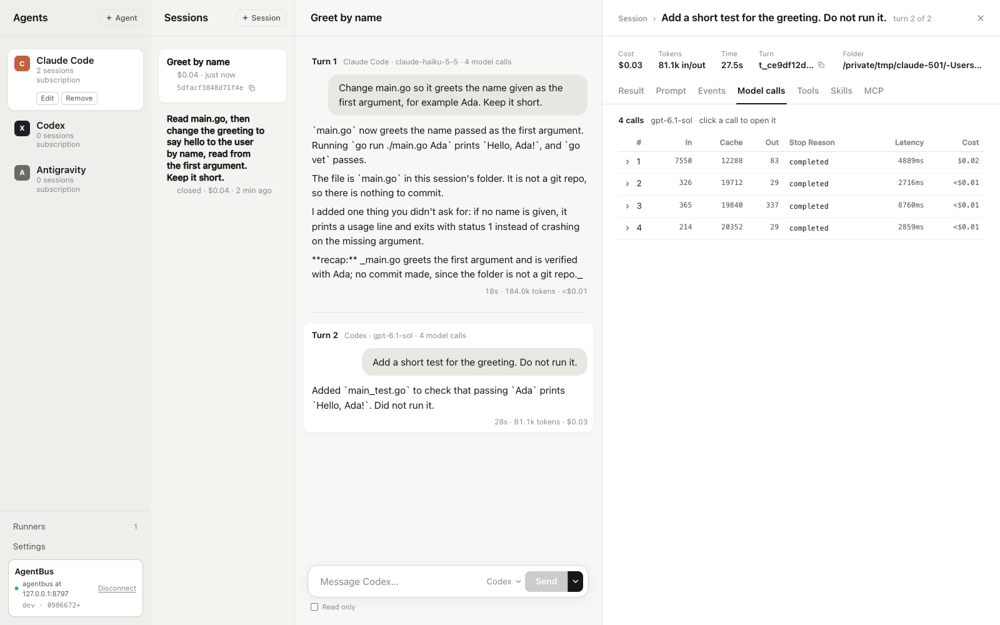
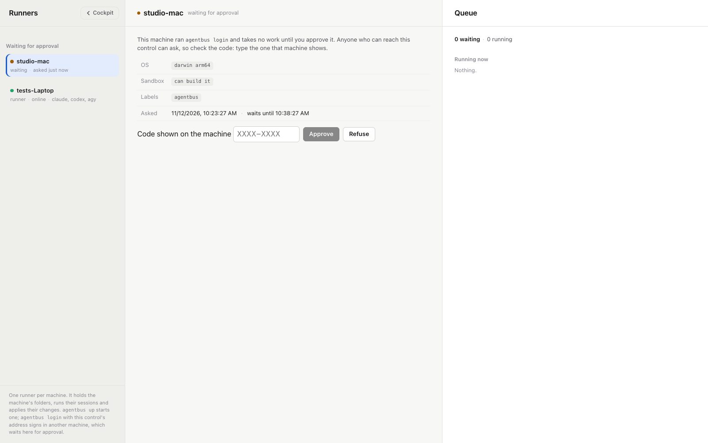

<div align="center">

<picture>
  <source media="(prefers-color-scheme: dark)" srcset="docs/assets/agentbus-logo-dark.svg">
  
</picture>

**A cross-vendor middleware framework for coding agents.**

[](https://github.com/staysup/agentbus/stargazers)
[](https://github.com/staysup/agentbus/releases)
[](https://github.com/StaysUp/agentbus/actions/workflows/ci.yml)

[Quickstart](#quickstart) &nbsp;&bull;&nbsp; [Add a machine](#add-a-machine) &nbsp;&bull;&nbsp; [Docs](#docs) &nbsp;&bull;&nbsp; [Cockpit](https://github.com/staysup/agentbus-cockpit) &nbsp;&bull;&nbsp; [Releases](https://github.com/staysup/agentbus/releases)

</div>



AgentBus sits between your coding agents and every model vendor. It runs the agents you already
have (Claude Code, codex, Antigravity), signed in as you, and records every step.

- **You see every model call**, and what it cost. Each request and reply is stored on your machine.
- **The conversation is kept.** Each turn is a fresh agent run. AgentBus keeps the history and
  continues the conversation from its own record, on any agent or model.
- **Your folder stays as it is.** Each session works in its own copy. Its changes reach your folder
  only when you apply a turn.
- **One API.** Cockpits, programs and agents all use the same HTTP API.

## Demo

[](https://youtu.be/si0HHQFcCD0)

## Install

You need macOS or Linux, and `claude`, `codex` or `agy` installed and signed in. Pick one:

```sh
brew install staysup/tap/agentbus
curl -fsSL https://raw.githubusercontent.com/staysup/agentbus/main/install.sh | sh   # into ~/.local/bin
go install github.com/staysup/agentbus/cmd/agentbus@latest                          # Go 1.27.1 or later
```

The install script takes `AGENTBUS_INSTALL_DIR` (another folder) and `AGENTBUS_VERSION` (another
release). Check the install with `agentbus version`.

## Quickstart

```sh
agentbus up
```

It listens on `http://127.0.0.1:8787` and prints its data folder: `$AGENTBUS_HOME`, else
`$XDG_DATA_HOME/agentbus`, else `~/.local/share/agentbus`. The file `token` there guards every API
call.

Then open a cockpit. The browser cockpit is
[staysup/agentbus-cockpit](https://github.com/staysup/agentbus-cockpit): follow its README and paste
the token when it asks.

Or start a turn with curl:

```sh
TOKEN=$(cat ~/.local/share/agentbus/token)
curl -s http://127.0.0.1:8787/api/v0/turns -H "Authorization: Bearer $TOKEN" \
  -d '{"agent":"claude","folder":"'"$PWD"'","prompt":"Say hello in five words.","model":"haiku"}'
```

The reply names the session and the turn. `GET /api/v0/turns?session=<id>` reads it back with its
reply and cost. Send the next message with `"session":"<id>"`. `GET /api/v0/turns/<turn>/diff`
shows what a turn changed, and `POST /api/v0/turns/<turn>/apply` puts it in your folder.

| `agentbus up` flag | Default | What it does |
|---|---|---|
| `-listen` | `127.0.0.1:8787` | The address. `0.0.0.0` can be reached from the network; the token guards it. |
| `-origin` | none | Allow only this browser origin, such as `http://localhost:5173`. |
| `-max-runs` | `4` | How many turns run at once, 1 to 64. More wait in the queue. |
| `-replay` | `true` | Continue sessions from AgentBus's own record. `false` uses the agent's own resume. |

There is no HTTPS. Across a network, use an SSH tunnel or a private network. In Docker, publish
the port to your own machine only: `docker run -p 127.0.0.1:8788:8787 …`.

## One program per machine

- **Control** keeps the API, the record, the job queue, the settings and the saved agents. It never
  touches your folders.
- **A runner** is the one program on each machine that holds code. It makes each session's copy,
  runs the agents, and applies changes back into the folder.

| Command | What runs |
|---|---|
| `agentbus up` | Control and this machine's runner, in one process. One machine needs only this. |
| `agentbus server` | Control alone. |
| `agentbus runner` | A runner. `agentbus login` sets one up (below). |

A session runs on one machine for its whole life: you pick the machine, then a folder on it.
Runners pull their work, so they work behind a router.

## Add a machine

Control runs `agentbus server -listen 0.0.0.0` (or `agentbus up`) somewhere you can reach. On each
machine that should do work:

**1. Install the binary into a folder of its own.** It must not replace another `agentbus` on your
`PATH`, such as an older one in `~/.local/bin`:

```sh
curl -fsSL https://raw.githubusercontent.com/staysup/agentbus/main/install.sh | \
  AGENTBUS_INSTALL_DIR="$HOME/.local/agentbus/bin" sh
"$HOME/.local/agentbus/bin/agentbus" version
```

Run it by its full path, as below. The service it sets up runs that same file.

**2. Sign the machine in.** Give it a data folder of its own, and name control's address:

```sh
AGENTBUS_HOME="$HOME/.local/share/agentbus-runner" \
  "$HOME/.local/agentbus/bin/agentbus" login http://<control>:8787
```

It prints a code and waits up to 15 minutes. It takes the runner's flags too: `-name` (default:
the host name), `-capacity` (turns at once, default 4), `-gateway local` (use this machine's own
sign-ins instead of control's), and `-no-service` (print the command instead of setting up a
service).

**3. Approve it.** In the cockpit, open **Runners** (at the foot of the Agents column). The machine
is under **Waiting for approval**. Type the code it shows and press **Approve**. Within 2 seconds
the machine saves its credential (`runner.json`, mode 0600) and sets up the service.



**4. The service.** It starts now and at every login:

| | macOS | Linux |
|---|---|---|
| Kind | launchd agent `art.lorebug.agentbus.runner` | systemd user unit `agentbus-runner.service` |
| File | `~/Library/LaunchAgents/art.lorebug.agentbus.runner.plist` | `~/.config/systemd/user/agentbus-runner.service` |
| Status | `launchctl print gui/$(id -u)/art.lorebug.agentbus.runner` | `systemctl --user status agentbus-runner.service` |
| Logs | `logs/runner-launchd.log` in the data folder | `journalctl --user -u agentbus-runner.service` |
| Restart | `launchctl kickstart -k gui/$(id -u)/art.lorebug.agentbus.runner` | `systemctl --user restart agentbus-runner.service` |
| Remove | `launchctl bootout gui/$(id -u)/art.lorebug.agentbus.runner`, then delete the file | `systemctl --user disable --now agentbus-runner.service`, then delete the file |

On Linux, `loginctl enable-linger` keeps it running while you are logged out. A file of that name
already there is never changed: login says so and prints the command to run instead. The service
keeps the `PATH` of the shell you ran login from, so run it where `claude`, `codex` and `agy` are
found.

**5. Check it is online.** The Runners page shows the machine as **Online** (it asked for work in the
last minute), and whether it can build a session's sandbox. `GET /api/v0/runners` on control says
the same. New sessions can now pick this machine.

To upgrade, replace the binary at the same path and restart the service. Control and every runner
must run the same release. An offline machine can be removed on the Runners page; its sessions stay
in the record.

**Sign-ins.** By default a runner holds no secrets: control adds the credential to each model call.
For an OpenRouter agent, control reads the key from its own environment. For your own
subscriptions, connect each once on control (`agentbus connect claude`, or Connect in the cockpit)
and press **Turn on for my runners** there (it sets `subscriptions_on_runners = "own"`). Or start the runner with `-gateway local`
to use the machine's own sign-ins.

### Upgrading to 0.5

- **Upgrade control and every runner together.** The runner protocol is now 4: control refuses a
  0.4 runner, and a 0.5 runner cannot join 0.4 control.
- **`agentbus connector` is retired.** It changes nothing and prints the `agentbus runner` line to
  run instead. Stop the connector and run that line with the same data folder: its `folders.json`
  keeps the machine's id and folders. If the connector shared control's data folder, give the
  runner a new one (`AGENTBUS_HOME`) and copy `folders.json` into it. Install the agents' programs
  on that machine: the runner now runs its sessions.
- **Enroll tokens still work**: `agentbus runner -server <url> -enroll-token-file ./enroll_token`.
  `agentbus login` needs none.
- **Settings move into control.** The first start of 0.5 copies the data folder beside it, then
  imports `permissions.toml`, `instructions.md` and `agents.json` once and never reads them again.
- **A default that changed keeps your old value.** In 0.5 an agent's own token no longer applies a
  turn (`[agent_api] apply`). A 0.4 data folder gets `apply = true` written into its settings, so
  nothing changes for you. Turn it off on the Settings page to take the new default.

## Settings

Control keeps the settings in `settings.db`: the permissions every turn runs under and the
instructions every turn gets. Change them on the cockpit's Settings page, or with
`PUT /api/v0/settings/permissions` and `PUT /api/v0/settings/instructions`. A change applies to the
next turn. Runners read control's settings before each turn. The keys and their defaults are in
`/docs`, under Settings. In short:

- `read_folders`, `allow`, `forbid`, `edit`, `subagents`: what a turn may read, run and edit
  without asking. `forbid` reads command text only; it is not a sandbox.
- `isolation`: how a session's copy is made (`auto`, `overlay`, `copy`, `git` or `none`).
- `[limits]` and `[agent_api]`: what agents may ask other agents for.
- `[network]`: on Linux, close agents off to a list of hosts. Off by default.
- `[sandbox]`: a wall around each session's agent, on macOS and Linux runners. Off by default.

## Running it

- **Logs** are in `logs/` in the data folder. `logs/service.log` is one line per request and per
  turn, with no token, header or body; it rolls at 10 MiB. `logs/runs/<session>.log` is what the
  agents printed, so it may hold your data.
- **Your data stays on your machine.** `events.db` holds every model request and reply, unencrypted,
  until you remove it. Headers, and so your sign-ins, are never stored. To clear it, stop the
  service and delete the data folder.
- **Overlay copies without root (Linux).** The service starts itself again in a user namespace of
  its own, so a copy is an overlay mount. Your own tools outside see an empty folder at the copy's
  path and reach it at `/proc/<pid>/root/<path>`; the log names the path. Ubuntu 24.04 and later
  need an AppArmor profile for this, which `install.sh` installs when run as root, or prints the
  command for. Without it, sessions use plain copies.
- **Keep the data folder on the machine's own disk.** A disk that keeps file times only to the
  second (a Mac folder shared into Docker, a network share) makes every apply look changed.

## Known limits

- OpenRouter turns show a cost of $0: the price table has no OpenRouter prices yet.
- A session stays on the machine that holds its folder.
- Network control is Linux only. On macOS, `contain = "on"` refuses every turn unless the sandbox
  is on.
- On ext4 a copy is a full copy. A clone (APFS) or a reflink (xfs, btrfs) is used where the disk
  can make one.
- An asked agent works in a fresh copy of your folder. It reads the asking turn's changes through
  the API, but does not have those files.
- agy runs on its own Google sign-in only, and gets no instructions of AgentBus's. A turn with
  `forbid` set, or `subagents = false`, is refused on agy. Using agy's sign-in on runners is at your
  own risk with Google: its terms (clause 6) forbid third-party tools, and it stays off unless you
  set `subscriptions_on_runners = "own"`.
- The API as tools (MCP) is off by default: `[agent_api] tools = true` turns it on for claude and
  codex.

## Docs

The running service describes its own API, without the token or the internet:

- `http://127.0.0.1:8787/docs`: the API reference, as a page.
- `http://127.0.0.1:8787/api/v0/openapi.json`: the same, as OpenAPI 3.1. It is the contract.
  Generate a client from it in any language.
- `http://127.0.0.1:8787/docs/llms.txt`: one short page for coding agents.

How runners talk to control is in [docs/RUNNER_PROTOCOL.md](docs/RUNNER_PROTOCOL.md). Third-party
code in the binary is listed in [THIRD_PARTY.md](THIRD_PARTY.md).

## License

Free to use, change and run, including inside your business. You can't sell it as a competing product or service. Each release becomes Apache 2.0 two years after it is published.

Licensed under the [Functional Source License](https://fsl.software) (FSL-1.1-ALv2). See [LICENSE](LICENSE).
